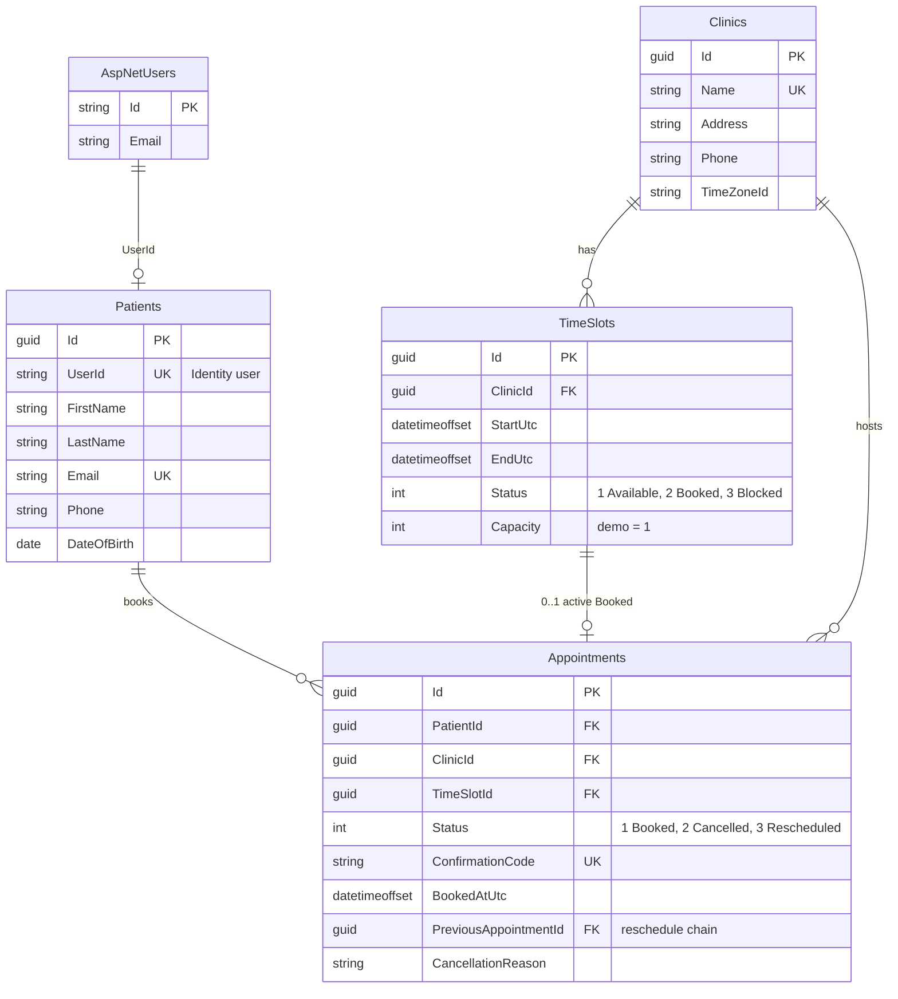
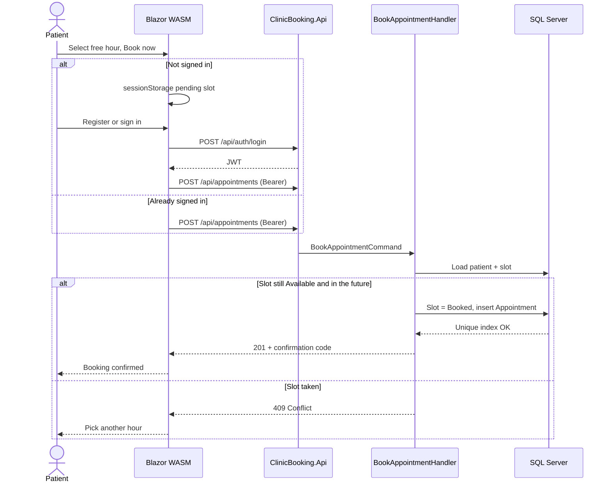
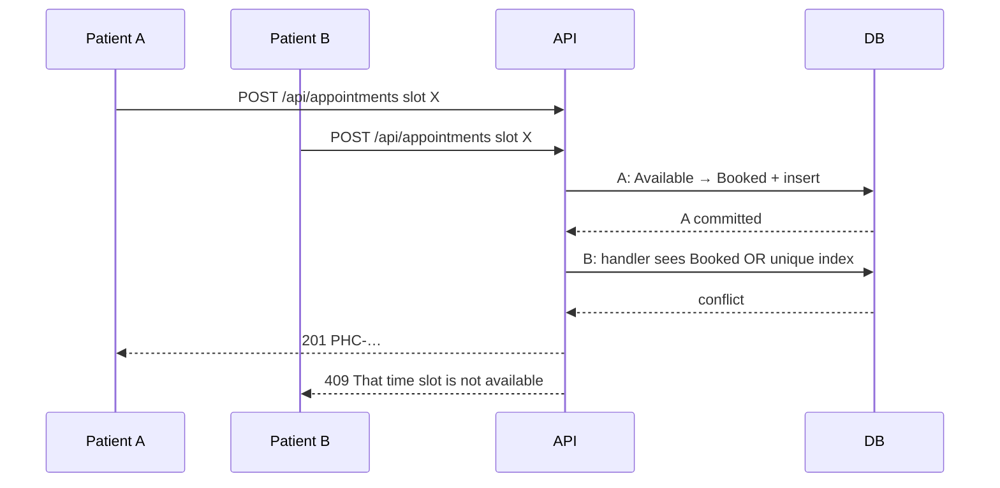
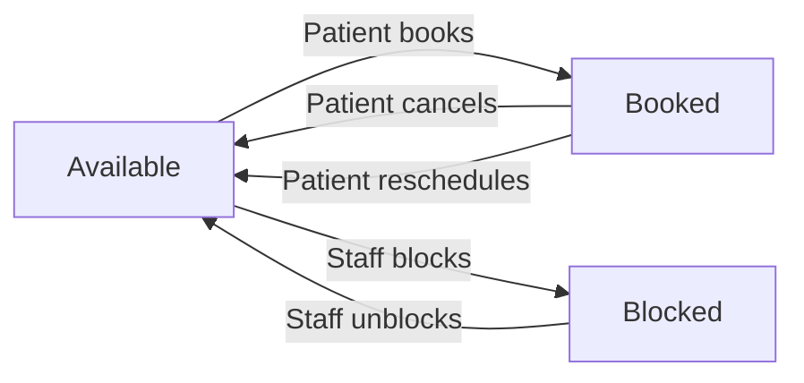

# Solution notes - PHCIS Clinic Booking

Written part of the senior practical (Tasks 1 and 2). The running product is the API + Blazor WASM in this repo.

Skipped on purpose (optional extras that cost more than they score): **GraphQL**, **Twilio / SendGrid**, **Outlook / Google Calendar**. **SignalR** is included: other browsers see a taken/cancelled/blocked cell without refresh.

## 1. Stakeholders

| Stakeholder | What they need | How the solution serves them |
|---|---|---|
| **Patient** | Book a clinic hour, see confirmation, cancel or move it | Public week grid, register/sign-in, JWT book, confirmation code, My appointments |
| **Clinic staff** | See who is coming; take hours off the board | Staff diary (names + codes). Block / unblock free cells. Public board never shows names |
| **System admin** | Seed clinics, keep the demo runnable | `admin@phcis.local`. Same Identity store. Docker Compose for a machine that is not Visual Studio |
| **PHCIS / markers** | Traceable architecture, no double-book, docs | Layered CQRS, unique index, tests, this file, Swagger |

Healthcare PHI is kept light: name, email, phone. No SA ID numbers, diagnoses, or clinical notes.

## 2. Functional requirements

| ID | Requirement | Where it lives |
|---|---|---|
| FR1 | Patient can see clinics | `GET /api/clinics`, Home page |
| FR2 | Patient can see available (and taken) time slots | `GET /api/clinics/{id}/slots` - status only, no PII |
| FR3 | Patient can book a slot and receive a confirmation | `POST /api/appointments` → `PHC-……`, Booking confirmed page |
| FR4 | No double booking | Handler re-check + filtered unique index `UX_Appointments_TimeSlotId_Booked` → **409** |
| FR5 | Cancel | `POST /api/appointments/{id}/cancel` frees the slot |
| FR6 | Reschedule | Old row stays `Rescheduled`; new `Booked` row with `PreviousAppointmentId` |
| FR7 | Register / login | ASP.NET Identity + JWT. Guest can pick a slot first; login completes the book |
| FR8 | Staff diary | `GET /api/staff/clinics/{id}/diary` - names only here |
| FR9 | Staff can block a free hour | `POST /api/staff/slots/{id}/block` |
| FR10 | Other browsers see a taken cell without refresh | SignalR `/hubs/slots` (status only, no names) |

## 3. Non-functional requirements

| ID | Requirement | How |
|---|---|---|
| NFR1 | Security | JWT (no cookies). Roles `Patient`, `ClinicStaff`, `Admin`. Book requires Patient. Public slots have no names |
| NFR2 | Integrity | Unique `(ClinicId, StartUtc)` on slots; unique booked appointment per slot |
| NFR3 | Auditability | Cancel / reschedule do not delete history rows |
| NFR4 | Observability | Serilog request logging. ProblemDetails for 400/404/409 |
| NFR5 | Portability | Visual Studio + LocalDB, **or** `docker compose up` (SQL + API + WASM) |
| NFR6 | Performance (demo) | One-hour weekday slots, range query max 14 days, covering indexes on clinic/start |
| NFR7 | Maintainability | Domain has no EF/HTTP/UI. Thin controllers. CQRS handlers own rules |
| NFR8 | Testability | xUnit + Moq handler tests + `WebApplicationFactory` against real SQL |

## 4. Architecture

Modular **layered monolith** - not microservices. Four tables and one booking rule do not need a service mesh.

```
ClinicBooking.Blazor     WASM + Fluent UI. HttpClient only.
        │ CORS + JWT
ClinicBooking.Api        Controllers, JWT, Swagger, Serilog
        │ MediatR
ClinicBooking.Application  Commands / queries / FluentValidation
        │ IAppDbContext
ClinicBooking.Infrastructure  EF Core + Identity + SQL Server
        │
ClinicBooking.Domain     Clinic, Patient, TimeSlot, Appointment
```

**CQRS and CORS are both required.** They are not alternatives.

- **CORS** is a browser rule so WASM on `:7276` (or Docker `:8081`) may call the API on another origin.
- **CQRS** is the API shape: `BookAppointmentCommand` changes state; `GetAvailableSlotsQuery` reads it. Controllers do not contain booking rules.

Request path:

Browser → CORS + JWT → Controller → MediatR → FluentValidation → Handler → EF transaction + unique index → SignalR `SlotChanged` to other browsers → confirmation DTO.

## 5. Data model

| Table | Role |
|---|---|
| `AspNetUsers` / roles | Login. Patient, staff, and admin share Identity |
| `Patients` | 1:1 profile for the Patient role (`UserId`) |
| `Clinics` | Soweto + Sandton seeded |
| `TimeSlots` | One-hour windows 08:00-16:00 SAST, weekdays. Status Available / Booked / Blocked |
| `Appointments` | One patient on one slot. Confirmation code. History on cancel/reschedule |

Capacity is **1**. A booked slot has exactly one active (`Status = Booked`) appointment.

### Indexes that matter

| Index | Why |
|---|---|
| `UX_Appointments_TimeSlotId_Booked` (filtered unique, `Status = 1`) | Database-level double-book lock |
| Unique `(ClinicId, StartUtc)` on `TimeSlots` | Two generators cannot create 09:00 twice |
| Unique `ConfirmationCode` | Lookup after booking |
| `(PatientId, BookedAtUtc)` | My appointments |

## 6. ERD

GitHub, Visual Studio, and most Markdown previews render this Mermaid diagram.



## 7. Sequence - successful book (including guest)



## 8. Sequence - two patients, one slot



The UI check is not the lock. The lock is the filtered unique index plus the handler status check.

## 9. Flow - slot lifecycle



Reschedule: old appointment row → `Rescheduled` (kept). Old slot → `Available`. New slot → `Booked` with a new appointment row pointing at the old id.

## 10. Stack vs the brief

| Brief item | In this repo |
|---|---|
| Blazor WASM | `ClinicBooking.Blazor` |
| Fluent UI (or MudBlazor) | Fluent UI 5 |
| FluentValidation | MediatR pipeline + command validators |
| HttpClient | `ClinicApiClient` |
| ASP.NET Core Web API | `ClinicBooking.Api` |
| EF Core + migrations | `AppDbContext`, `Persistence/Migrations` |
| AutoMapper | `MappingProfile` (clinic / slot DTOs) |
| Serilog | API `Program.cs` |
| SQL Server | LocalDB in Visual Studio; SQL 2022 in Docker |
| Identity + JWT | IdentityCore, no cookies |
| xUnit + Moq | Handler tests + `BookingTests` |
| Swagger | `/swagger` |
| Docker | `docker compose up --build` |
| GitHub Actions | `.github/workflows/ci.yml` |
| GraphQL / Twilio / Calendar | **Skipped** (optional) |
| SignalR | `SlotBoardHub` `/hubs/slots` - live slot status, no PII |
| Playwright / bUnit | **Not built** - Task 4 asks for basic unit tests; those are xUnit |

